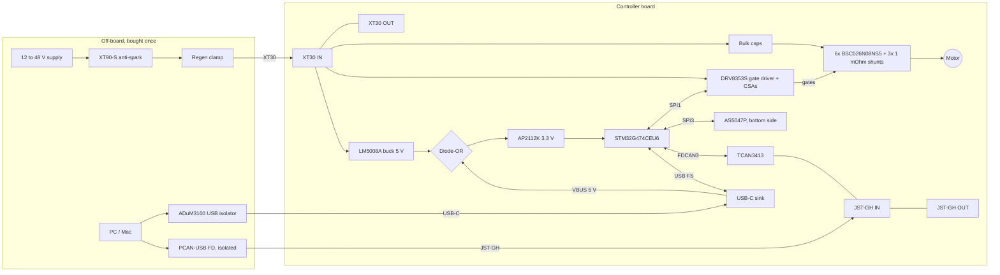

# Low-cost PMSM Controller: Electronics Design

Implements the hardware side of `requirements.md`. Firmware design is a separate doc (`design-firmware.md`).

## Overview
- One 50 × 50 mm, 4-layer board per motor: STM32G474 + DRV8353S + LM5008A buck + 6 MOSFETs + AS5047P encoder + CAN FD, daisy-chained by XT30 power and JST-GH CAN.
- Guiding rule: minimum part count. Protection and isolation live off-board (anti-spark switch, regen clamp, isolated PC adapters); bus current is computed in firmware, not sensed.

## Components
- MCU: STM32G474CEU6, UFQFPN-48 7×7. 170 MHz M4F, 512 KB dual-bank flash, FDCAN, USB FS. JLC C1235412. Rated 85 °C ambient: placed away from the MOSFETs; firmware also limits on the MCU's internal temperature sensor. Buy all run MCUs up front (175 in stock).
- Clock: 16 MHz crystal (HSE), YXC X322516MLB4SI, 3225, CL 9 pF, ESR 50 Ω, ±10 ppm, JLC basic part C13738. Crystal gm_crit = 4·ESR·(2πf)²·(C0+CL)² ≈ 0.3 mA/V (C0 ≈ 3 pF), under the STM32G474 limit of 1.5 mA/V (DS12288 Table 41). PLL: 16 / 4 × 85 = 340 MHz VCO; /2 → 170 MHz SYSCLK; /4 (PLLQ) → 85 MHz FDCAN kernel: 17 tq/bit at 5 Mbps, 85 tq/bit at 1 Mbps. USB clock from internal HSI48 trimmed by CRS.
- Gate driver: TI DRV8353SRTAT, WQFN-40 6×6. 3 low-side CSAs (10 MHz bandwidth; the R variant's are 1 MHz), SPI, internal gate supplies. VM 9 to 75 V recommended, 80 V abs max. JLC C2150480. 6x PWM mode. IDRIVE about 300 mA source / 600 mA sink, giving about 0.9 V/ns phase slew (limit 2 V/ns). VREF tied to the MCU's 3.3 V analog supply (ratiometric). SDO pull-up (open drain). ENABLE stays high while running; Idle = all PWM inputs low (ENABLE low sleeps the DRV, resets registers, and stops the CSAs).
- Logic buck: TI LM5008AMMX, VSSOP-8, standalone. JLC C2071250. 5 V out, values in Appendix D.
- MOSFETs: 6 × Infineon BSC026N08NS5, TDSON-8 5×6. 80 V, 2.6 mΩ at 10 V, Qg 74 nC. JLC C5955453.
- Current sense: low-side, 3 × 1 mΩ 3 W 2512 (JLC C2903470), CSA gain 20 V/V. 20 mV/A, about ±70 A usable, about 40 mA per ADC count. Sampled at PWM center; duty capped so the low-side window stays ≥ 2 µs (CSA settling plus ADC sample).
- Overcurrent: shunt outputs also feed MCU comparators (COMP1/3/4, DAC thresholds) wired to TIM1 break input: hardware trip at the configured level within one PWM period (FR24). DRV8353 VDS overcurrent set to about 0.3 V, latched, as short-circuit backstop. Independent watchdog enabled by option byte.
- Encoder: ams AS5047P-ATSM, TSSOP-14, alone on the motor-facing (bottom) side at board center. JLC C962063. 14-bit SPI, dynamic angle error compensation (built-in latency correction), designed for motor commutation, rated to 28 krpm. 3.3 V operation per datasheet (DS000324 v2-00, Power Management, Figure 10): VDD and VDD3V3 tied together to the 3.3 V rail (3.0 to 3.6 V), one 100 nF decoupling capacitor. 15 mA. SPI mode 1, up to 10 MHz, on its own SPI port (SPI3) so USB-only readout never clocks the unpowered DRV.
- CAN: TI TCAN3413DRBR, VSON-8 3×3, 3.3 V only, CAN FD to 8 Mbps, ±58 V bus-fault rated (no extra TVS). JLC C22445415. Placed within a few mm of the CAN connectors. Termination: 120 Ω across CANH/CANL through a 1-position SMD slide DIP switch (JLC C6386918), on at the first and last board (FR38). Connector GND pin to board ground through 100 Ω so CAN GND never carries chain return current.
- Logic power: LM5008A buck 5 V and USB VBUS 5 V, OR'd by two B5819W Schottky diodes (SOD-123, 40 V 1 A, JLC basic C8598), into AP2112K-3.3 LDO (Diodes Inc, SOT-23-5, 600 mA, 250 mV typ dropout, JLC C51118). USB-C sink only: 5.1 kΩ on CC1/CC2, no PD. USB ESD: USBLC6-2SC6 (JLC C2687116). 1 µF on USB VBUS at the connector (USB max 10 µF).
- Bulk capacitance: 4 × 47 µF 80 V polymer, 10 × 10 mm, 2.7 A ripple, 30 mΩ (MA80V47M10X10, JLC C54321633; 80 V ≥ 1.2 × 54 V hard trip) + 6 × 4.7 µF 100 V X7R 1210 at the bridge. Ripple current at 20 A RMS is about 13 A.
- Bus voltage: divider 100 kΩ / 5.1 kΩ (about 68 V full scale, 16.6 mV per count) + RC filter → ADC.
- Board temperature: Murata NCP15XH103F03RC NTC (10 kΩ, B 3380 K, 0402, JLC C77131) next to the MOSFETs, with a 10 kΩ 1% resistor to 3.3 V → ADC (FR28).
- Bus current (FR37): computed in firmware, I_bus = 1.5 × (Vd·Id + Vq·Iq) / V_bus, about ±10% (ignores switching losses). Same value drives the regen limit (FR33, negative = power returned) and lets the host check the 15 A chain budget (FR35). No sensor.
- Connectors: power 2 × Amass XT30PW-F female (IN and OUT, JLC C2913282), 15 A continuous, both on the same edge. Female on the board so the live side of every link is shrouded; chain leads are male-to-male. Pad 2 = + (flat end of the housing), pad 1 = − (rounded end), checked on a physical XT30PW-F; CAN 2 × JST-GH 3-pin SM03B-GHS-TB (JLC C514175: CANH, CANL, GND; GND is the reference for the isolated PC adapter); USB-C 16-pin USB 2.0 receptacle. All on board edges.
- Debug: 5 bare pads in a 2.54 mm row (3V3, SWCLK, GND, SWDIO, NRST), not fitted, for an ST-LINK (the Nucleo's CN4). Debugging only; firmware loads over USB-C. Hand-solder a 1×5 header on the boards you debug. BOOT0 pad next to a 3V3 pad, 10 kΩ pull-down on PB8-BOOT0, for ROM DFU recovery.
- Status: one bicolor LED (green OK, red fault), not on PC13 to PC15 (3 mA limit).
- Test pads: SOA/SOB/SOC, VBUS, 5 V, 3V3, nFAULT. No snubber pads: phase-node ringing is controlled by a tight hot loop (layout) and DRV8353S IDRIVE (SPI). A bad ring on the first board means a layout respin.
- PCB: 4 layers, 2 oz outer copper, 1.6 mm. All parts on top except the encoder; bottom flat for a thermal pad (FR4). M3 holes on 25 mm and 30 mm circles (NFR2).

## Supporting components (per each chip's datasheet)
| Chip | Pin / function | Part | Source |
|---|---|---|---|
| STM32G474 | VDD × 3 (pins 23, 35, 48) | 100 nF each + one 4.7 µF | DS12288 §5.1.6, Figure 16 |
| STM32G474 | VDDA (pin 21) | 10 nF + 1 µF | Figure 16 |
| STM32G474 | VREF+ (pin 20), tied to VDDA (no VREFBUF) | 100 nF + 1 µF | Figure 16 |
| STM32G474 | VBAT (pin 1), tied to VDD (no battery) | shares VDD decoupling | §3.11.6 |
| STM32G474 | NRST | 100 nF to GND (internal 40 kΩ pull-up) | Figure 27 |
| STM32G474 | PB8-BOOT0 | 10 kΩ pull-down + BOOT0 pad | §3.7 boot modes |
| STM32G474 | HSE PF0/PF1 | 2 × 10 pF C0G | Table 41 note; AN2867: CL1 = CL2 = 2 × (CL − Cstray), CL 9 pF, Cstray ≈ 4 pF |
| STM32G474 | Exposed pad | VSS | Figure 5 |
| DRV8353S | VM | 0.1 µF X7R VM-rated (100 V) + ≥ 10 µF VM-rated (bulk caps) | SLVSDY6A Table 21 |
| DRV8353S | VDRAIN | to bus at the high-side drains, 0.1 µF shared with VM | Figure 63 |
| DRV8353S | VCP to VM | 1 µF X7R 16 V | Table 21 |
| DRV8353S | VGLS to GND | 1 µF X7R 16 V | Table 21 |
| DRV8353S | CPH to CPL | 47 nF X7R, VDRAIN-rated (100 V) | Table 21 |
| DRV8353S | DVDD to DGND | 1 µF X7R 6.3 V | Table 21, pin table |
| DRV8353S | VREF to AGND | 0.1 µF X7R 6.3 V (Figure 63 shows 1 µF; either) | pin table |
| DRV8353S | SDO (open drain) | 1 kΩ pull-up to 3.3 V | Figure 63 |
| DRV8353S | nFAULT (open drain) | 10 kΩ pull-up to 3.3 V | Figure 63 |
| DRV8353S | nSCS | internal 50 kΩ pull-up to DVDD (5 V): drive from a 5 V-tolerant (FT) MCU pin | §7.5 RPU |
| DRV8353S | ENABLE, INHx, INLx, SCLK, SDI | internal 100 kΩ pull-downs, no external parts | §7.5 RPD |
| LM5008A | all | per Appendix D | SNVS583H §8.2 |
| AS5047P | VDD + VDD3V3 tied | 100 nF | DS000324 Figure 10 |
| AS5047P | CSn | 10 k pull-up to 3.3 V, so CSn never floats while the MCU is in reset or ROM DFU | DS000324 pin table, note 1 (floating inputs not allowed) |
| TCAN3413 | VCC, VIO (both 3.3 V) | 100 nF each | SLLSFS8A §8.4 |
| TCAN3413 | STB | integrated pull-up (defaults to standby): MCU drives low to operate | pin table |
| TCAN3413 | TXD | integrated pull-up, no external parts | pin table |
| AP2112K-3.3 | VIN, VOUT | 1 µF X7R each; EN tied to VIN (internal 3 MΩ pull-down) | Diodes datasheet, typical application, Note 4 |
| USB-C receptacle | CC1, CC2 | 5.1 kΩ each to GND (sink) | USB Type-C spec |
| USBLC6-2SC6 | VBUS, D+, D− | no external parts | ST datasheet |

## Layout rules
- Encoder field: XT30 IN and OUT on the same edge so pass-through current and its return never cross the board center. Bridge and phase traces ≥ 12 to 15 mm from the encoder. Every high-current path routed with its return on the adjacent layer so the fields cancel.
- Pass-through: 15 A as planes on several layers (IPC-2221: about 6.3 mm of 2 oz outer copper for 10 K rise).
- MCU and JST-GH (both 85 °C parts) on the cool side, away from the MOSFETs.
- TCAN3413 within a few mm of the CAN connector pair (short stubs at 5 Mbps).
- Kelvin taps: each shunt's net tie sits on that shunt's own pad: NT1/NT3/NT5 on the top pad of R8/R9/R10 (low-side source side), NT2/NT4/NT6 on the bottom pad (GND side). Never tap the GND plane or a trace carrying phase current. The SPx/SNx pair leaves from the inner edge of the pads and runs side by side to the DRV8353S, away from the power path. DRC cannot check this (the net tie joins the nets anywhere on them), so it is a manual review item on every layout render.

## Interfaces (MCU pins, UFQFPN-48)
| Function | Pins |
|---|---|
| TIM1 CH1-3 / CH1N-3N → DRV INHx/INLx | PA8/9/10, PB13/14/15 |
| SPI1 → DRV8353 (+ nSCS, ENABLE, nFAULT) | PA5/6/7 |
| SPI3 → AS5047P (+ CSn) | PC10/PC11/PB5 |
| SOA / SOB / SOC → ADC + comparator | PA0 (ADC1, COMP3) / PA1 (ADC2, COMP1) / PB0 (ADC3, COMP4) |
| VBUS / NTC | PA2 / PA3 |
| FDCAN3 → TCAN3413 | RX PB3, TX PA15 |
| USB | PA11 / PA12 |
| SWD / BOOT0 | PA13 / PA14, NRST / PB8 |
| HSE crystal | PF0 / PF1 |
| DRV nSCS (needs 5 V-tolerant: internal pull-up to DVDD) / ENABLE / nFAULT | PB7 (FT_f) / PB11 / PB10 |
| Encoder CSn / TCAN3413 STB | PB12 (TT_a, 3.3 V only) / PB9 |
| LED green / red | PB1 / PB2 |
| Unused (no-connect) | PA4, PB4, PB6, PC4, PC6, PC13, PC14, PC15 |

TIM1 CH2/CH3 sit on PA9/PA10, which also switch the USB-C dead-battery pull-downs on PB4/PB6: firmware disables them (PWR_CR3 UCPD_DBDIS) first thing at boot.

## Power-up behavior
1. User connects DC with the supply off, then switches on (or plugs in through the XT90-S anti-spark).
2. Bulk caps charge; LM5008A starts at VIN ≥ 6 V and makes 5 V.
3. Diode-OR picks the higher of buck 5 V and USB 5 V; LDO makes 3.3 V; MCU boots.
4. MCU configures the DRV8353 over SPI, holds all PWM inputs low until config is loaded and checks pass.

USB only: logic runs, DRV8353 unpowered, motion refused (FR48). DRV SPI and control lines held low while VM is absent; encoder still readable on SPI3.

## Thermal budget (20 A RMS, 48 V)
| Source | Estimate |
|---|---|
| MOSFET conduction | 3.6 W |
| MOSFET switching | 1 to 2.5 W |
| Shunts, copper | about 1 W |
| DRV8353 + buck self-heating | about 1.3 W |
| XT30 contacts at 15 A pass-through (4 × 1.2 mΩ) | about 1.1 W |
| **Total** | **about 8 to 9.5 W** |

## Key Decisions
- D1. Bus: CAN FD, 1 Mbps arbitration / 5 Mbps data. Alternative: classic CAN. Why: 8 nodes × 1 kHz needs about 2 Mbps of payload. Constraint for the protocol: each 1 ms cycle is one broadcast setpoint frame (all 8 nodes, 64 bytes) plus one ≤ 20-byte reply per node, about 0.74 ms of bus time.
- D2. MCU: STM32G474CEU6. Alternatives: G431, F446, ESP32-S3, ATmega328P. Why: only option passing all hard gates (CAN FD, native USB, 2 firmware images, PWM-synced ADC). See Appendix A.
- D3. Gate driver: DRV8353S + standalone LM5008A. Alternatives: DRV8353RS (integrated LM5008A, but 1 MHz CSAs too slow), DRV8323RS, DRV8334, DRV8363. Why: no external gate supply, fast CSAs, SPI diagnostics; VM 80 V abs max leaves 28 V over the 52 V setting. See Appendix B.
- D4. Current ratings: 10 A RMS no heatsink, 20 A RMS with heatsink. Alternative: 20 A no heatsink. Why: a 50 × 50 mm board cannot shed 8 to 9.5 W in still air. At a 10 to 12 V bus the DRV gives only 6 to 7.5 V of gate drive (Rds 3.9 mΩ); FR28 temperature derating covers it, no separate rule. See Appendix C.
- D5. MOSFET: BSC026N08NS5. Alternatives: BSC021N08NS5 (2.1 mΩ, $2.96), BSC030N08NS5 (3.0 mΩ, $0.82). Why: Infineon quality, good stock, $1.28.
- D6. Qg limit ≤ 100 nC. Why: DRV8353 datasheet Eq. 12, sinusoidal drive, `I_VCP > 3 × Qg × f_PWM`; worst case 15 mA at 10 V bus and 20 kHz allows 250 nC.
- D7. Low-side sensing into DRV8353S CSAs. Alternatives: inline (3 external amps), high-side. Why: zero extra parts. Requires the fast (non-R) CSAs and a duty cap leaving a ≥ 2 µs low-side window.
- D8. Encoder: AS5047P on the motor-facing side. Alternative: AS5048A (PoC part); reading through the PCB (not feasible: needs 0.6 to 2.3 mm magnet gap). Why: dynamic angle error compensation for high speed, designed for FOC commutation; same SPI frame as the PoC driver.
- D9. No on-board inrush limiting. Alternative: LM5069 hot-swap per board. Why: minimal parts; one external anti-spark switch protects the whole chain (FR40). Live plugging also exceeds the DRV VDRAIN 2 V/µs slew limit: user docs mark it as damaging.
- D10. No on-board isolation. Alternative: ADuM4160 + isolated CAN per board. Why: two isolated PC adapters bought once protect the PC (FR49).
- D11. Power connector: XT30PW. Alternative: XT60PW (30 A). Why: smaller; 15 A / 720 W chain budget is enough for a hobby arm (FR35).
- D12. Termination: slide DIP switch. Alternatives: solder jumper, firmware-controlled analog switch. Why: one $0.49 part, no soldering, no firmware.
- D13. 16 MHz crystal, FDCAN clocked from PLLQ at 85 MHz. Alternatives: 40 MHz crystal (FDCAN straight from HSE), internal HSI. Why: HSI is ±1%, too loose for CAN FD; 40 MHz crystals need CL ≤ 8 pF and ESR ≤ 40 Ω to meet the 1.5 mA/V gm limit, while the 16 MHz basic part has 5× margin; 85 MHz gives whole time quanta at both bit rates.
- D14. SWD as unfitted 2.54 mm pads. Alternatives: JLC-fitted header (a part on every board for a debug-only port), Tag-Connect TC2030 (cable to buy). Why: SWD is debug only, since firmware loads over USB-C DFU; works with the Nucleo's ST-LINK.
- D15. Regen: firmware limit (FR33) + flux braking above the OV setting (FR26) + one external regen clamp for power-supply users. Alternative: on-board brake resistor. Why: matches moteus (firmware limits) and ODrive (external Regen Clamp); each board alone absorbs only about 22 mJ between 48 and 52 V.
- D16. Bulk caps: 4 × 47 µF 80 V polymer + 6 × 4.7 µF 100 V ceramic. 63 V parts fail the 1.2 × 54 V derating. Alternative: 1 polymer + 4 ceramics. Why: about 13 A ripple at 20 A RMS; each polymer is rated 2.7 A (10.8 A total), ceramics carry the high-frequency share.
- D17. No per-board fuse. Why: user choice; a shorted board can take down the chain.

## Parts to buy (off-board)
| # | Item | Qty | Requirement |
|---|---|---|---|
| B1 | Amass XT90-S anti-spark pair + XT90-to-XT30 male adapter lead | 1 per chain | FR40 |
| B2 | ADuM3160 USB isolator module (12 Mbps full speed, 2.5 kV) | 1 | FR49 |
| B3 | PEAK PCAN-USB FD (500 V isolated); macOS via MacCAN PCBUSB library | 1 | FR49, FR55 |
| B4 | Diametric magnet 6 × 2.5 mm N35 (Radial Magnets 9042, DigiKey; not sold by JLC) | 1 per motor | Encoder |
| B5 | 40 × 40 × 30 mm finned heatsink + thermal pad (20 A rating only) | 1 per board, optional | FR4 |
| B6 | XT30 male-to-male power jumpers, JST-GH 3-pin CAN jumpers (pin 1 to pin 1) | per chain link | FR34 |
| B7 | Regen clamp / brake-resistor module, ≥ 56 V rated, for power-supply use | 1 per chain | FR33 |

## Open Questions
- OQ1. Thermal acceptance test on the first board: lock the rotor at the worst-case electrical angle (one leg carrying the most current), hold 10 A (no heatsink) then 20 A (with B5), with 15 A flowing through the pass-through at the same time, until steady; pass if ≤ 90 °C at 25 °C ambient. Derate published ratings if it fails.
- OQ2. Pick the B7 regen clamp model (ODrive Regen Clamp is sold out).
- OQ3. Check CSA settling and the duty cap on the first board (scope SOx at maximum duty).
- OQ4. Check HSE frequency on the first board (MCO output vs a frequency counter); trim the 10 pF load caps if off by more than the crystal's ±10 ppm.

## USB-only power budget (3.3 V rail, datasheet max values)
| Load | Max | Source |
|---|---|---|
| STM32G474, Run 170 MHz, peripherals off | 35 mA (55 °C) | STM32G474 datasheet, IDD(Run) table |
| STM32G474 peripherals (USB, ADC, timers, FDCAN) | about 30 mA | estimate |
| AS5047P | 15 mA | AS5047P datasheet, IDD |
| TCAN3413, dominant into 60 Ω | 55 mA (2 µA in standby) | TCAN3413 datasheet §5.6 |
| Bicolor LED | 10 mA | design choice |
| **Total** | **about 145 mA** | |

DRV8353S and LM5008A draw nothing from USB (powered from the bus only). Firmware holds the TCAN3413 in standby when no bus power is present, dropping the total to about 90 mA. Not separately verified: 25% margin even at worst case, and an overload only browns out the logic (USB disconnects), with no damage.

## Appendix A: MCU decision matrix

Ranking per criterion, 1 = best; lowest sum wins.

| Option | Processing power | PWM frequency | Size | Cost | **Sum** |
|---|---|---|---|---|---|
| STM32G474 | 2 | 1 | 3 | 4 | **10** |
| STM32G431 | 3 | 3 | 1 | 3 | **10** |
| ESP32-S3 | 1 | 4 | 4 | 2 | **11** |
| ATmega328P | 5 | 5 | 2 | 1 | **13** |
| STM32F446 (PoC) | 4 | 2 | 5 | 5 | **16** |

| Option | Processing | PWM timer | Smallest package | Approx. unit cost |
|---|---|---|---|---|
| STM32G474 | 170 MHz M4F + CORDIC, 128 KB RAM | 170 MHz timers + HRTIM (184 ps) | QFN48 7×7, no crystal needed | about $5 to 7 (JLC: $15.01, C1235412) |
| STM32G431 | Same core + CORDIC, 32 KB RAM | 170 MHz timers | QFN32 5×5 | about $3 |
| ESP32-S3 | 2 × 240 MHz Xtensa, FPU | 160 MHz MCPWM | QFN56 7×7 + ext. flash + crystal | about $3 |
| ATmega328P | 16 MHz 8-bit, no FPU | 16 MHz, about 400 steps at 20 kHz | QFN32 5×5 + crystal | about $1.5 to 2 |
| STM32F446 | 180 MHz M4F, no CORDIC | 180 MHz timers | LQFP64 10×10 | about $6 to 8 |

Hard gates, applied before scoring:

| Gate | G474 | G431 | ESP32-S3 | ATmega328P | F446 |
|---|---|---|---|---|---|
| CAN FD built in | ✅ | ✅ | ❌ classic only | ❌ no CAN | ❌ classic only |
| Native USB (FR47) | ✅ | ✅ | ✅ | ❌ | ✅ |
| Flash for 2 firmware images + config/cogging (FR51) | ✅ 512 KB dual-bank | ❌ 128 KB | ✅ external | ❌ 32 KB | ✅ 512 KB |
| Current-sense ADC synced to PWM | ✅ | ✅ | ❌ weak ADC | ⚠️ one slow ADC | ✅ |

Only the STM32G474 passes every gate.

## Appendix B: Gate driver selection

Why DRV8353S (+ standalone LM5008A):
- Gate supply internal: charge pump (high side) and VGLS regulator (low side) run straight from the bus. No external 12 V rail, which a 10 V minimum bus could not produce from a buck.
- S = SPI: gains, gate drive strength, and detailed fault registers readable by the MCU (FR29).
- Fast CSAs: 10 MHz unity-gain bandwidth. The DRV8353**R** variants (integrated buck) have 1 MHz CSAs (SLVSDY6A §7.5), needing about 12 to 15 µs to settle at gain 20: too slow for PWM-center sampling at high duty. The R's buck is an LM5008A die, so the same LM5008A is placed separately.
- Voltage: VM 75 V recommended, 80 V abs max (VDRAIN sense pin 102 V). 28 V margin over the 52 V setting.
- 3 low-side CSAs (gain 5/10/20/40) built in.
- Fallback: DRV8323S class (65 V) if stock fails.

TI 3-phase smart gate drivers reviewed (TI product pages, 2026-10-19):

| Part | Abs max | CSAs | Gate supply | Interface | Package | Fit |
|---|---|---|---|---|---|---|
| DRV8304 | 40 V | 3 | internal | SPI / HW | 6×6 QFN-40 | ❌ voltage |
| DRV8305 (PoC) | 45 V | 3 | internal | SPI | 7×7 QFN-48 | ❌ voltage |
| DRV8302 | 65 V | 2 | internal | HW only | 14×8 HTSSOP-56 | ❌ size, no SPI |
| DRV8320 | 65 V | 0 | internal | SPI / HW | 5×5 QFN-32 | ❌ no CSAs |
| DRV8329 | 65 V | 1 (summed) | internal | HW only | 4×5 QFN-36 | ❌ one CSA |
| DRV8300 | 100 V | 0 | external 5 to 20 V | HW only | 4×4 QFN-24 | ❌ no CSAs |
| DRV8343-Q1 | 65 V | 3 | internal | SPI / HW | 9×9 HTQFP-48 | ⚠️ too big |
| DRV8323RS | 65 V | 3 | internal | SPI | 7×7 VQFN-48 | ⚠️ 65 V margin thin |
| DRV8334 | 65 V | yes, sub-1 mV offset | internal | SPI | 7×7 QFN-48 | ⚠️ newer, 65 V |
| DRV8353RS | VM 80 V | 3, **1 MHz** | internal | SPI | 7×7 VQFN-48 | ❌ CSAs too slow |
| **DRV8353S** | **VM 80 V** | **3, 10 MHz** | **internal** | **SPI** | **6×6 WQFN-40** | **✅ chosen** |
| DRV8363 | 85 V | 3, 1 mV offset | external 8 to 15 V | SPI | 7×7 QFN-48 | ⚠️ needs 12 V rail |

## Appendix C: Thermal rating basis

Steady-state max phase current from mjbots' moteus model (`docs/mpat.html`, measured loss curves and °C/W per cooling), 25 °C ambient. Units as reported by moteus (RMS vs peak not stated).

| Board (size) | Bus | No cooling | Heat spreader | 40×40×30 sink | 5 V fan | Temp limit |
|---|---|---|---|---|---|---|
| c1 (38×38) | 24 / 48 V | 5.5 / 3.7 A | 5.5 / 3.7 A | n/a | 14.8 / 13.3 A | 60 °C |
| r4 (46×53) | 24 / 36 V | 12.6 / 10.5 A | 14.2 / 12.2 A | 17.9 / 16.0 A | 24.9 / 22.9 A | 60 °C |
| n1 (46×46) | 24 / 48 V | 9.4 / 4.2 A | 11.2 / 6.0 A | 14.5 / 9.3 A | 21.8 / 16.7 A | 60 °C |
| x1 (56×56) | 24 / 48 V | 27.0 / 22.0 A | 26.0 / 21.0 A | 32.7 / 27.2 A | 51.4 / 44.1 A | 100 °C |

The r4 is the closest in size. Our 90 °C limit adds headroom over moteus's 60 °C. All moteus boards specify a 10 V minimum bus and derate power at high voltage, not current at low voltage. Ratings are validated by OQ1.

## Appendix D: Buck regulator values

Topology and parts per DRV8353 datasheet (SLVSDY6A) Table 22 (the same LM5008A, now standalone); values sized with the LM5008A datasheet (SNVS583H) §8.2 procedure, re-run for 5 V out, 10 to 52 V in, 300 mA.

| Part | TI example (10 V out) | Ours (5 V out) | Basis |
|---|---|---|---|
| RFB2 (VOUT to FB) / RFB1 (FB to GND), per TI Fig. 10 | 3.01 k / 1.0 k | 1.0 k / 1.0 k | VOUT = 2.5 × (RFB1 + RFB2) / RFB1 |
| RT | 324 k | 240 k, YAGEO RC0603FR-07240KL (JLC C137765): Fs ≈ 150 kHz, on-time 616 ns at 54 V, 410 ns at the worst-case −33% spread (TON-2: 200 / 300 / 420 ns), so ≥ 400 ns across the whole input range | Eq. 4, Fs = VOUT / (1.385e-10 × RT) |
| L1 | 220 µH | 120 µH, Isat ≥ 610 mA: SWPA6045S121MT (C96952, 850 mA) | Eq. 8, ripple 250 mA p-p at 54 V (314 mA with L at −20%); peak 0.31 A at 150 mA load < 0.41 A min current limit |
| RCL | 332 k | 383 k (7.5 µs) | Eq. 5, same tolerance steps as TI |
| R3 | 3.0 Ω | 1.0 Ω | ≥ 25 mV p-p at FB; TI range 0.5 to 3 Ω |
| D1 | DFLS1100 | DFLS1100-7 (C107674) | ≥ VIN max, ≥ 610 mA |
| C1 / C2 / C3 / C4 / C5 | 1 µF 100 V / 22 µF 25 V / 0.47 µF / 0.01 µF / 0.1 µF 100 V | same | TI BOM |
